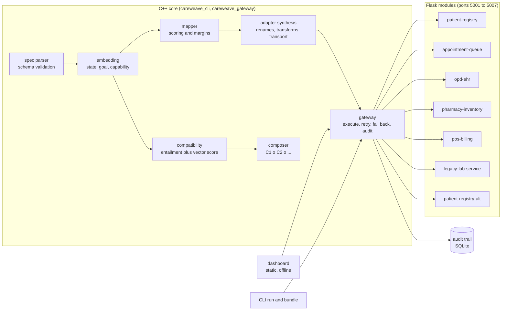
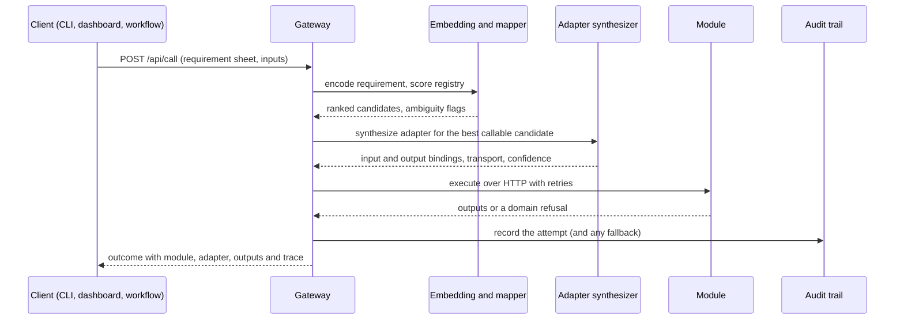

# CareWeave Mini

CareWeave Mini is a working embedding-driven application platform. It represents formally
specified capabilities, states and goals as vectors, uses that representation to resolve new
requirements against a live capability registry, synthesizes an adapter for the chosen
capability, executes it against a real service, and proves that the same representation can
compose capabilities into composites. The hospital application is the demonstration: seven
independently runnable modules (patients, queue, consultations, pharmacy, billing, labs and a
legacy registry), a C++ gateway that unifies them, and a dashboard that exposes the whole
pipeline.

- Embedding: three deterministic embeddings (state, goal, capability) over one shared
  condition subspace, with a partitioned 259 dimensional capability vector.
- Mapping: a scored ranking of registry capabilities against a requirement, with visible
  ambiguity margins and a kind tie break.
- Adapters: synthesized field renames, transforms and transports, executed over HTTP, SQLite,
  files or in process, with fallback and per module circuit breaking.
- Compatibility: symbolic entailment plus a signed vector score, reported side by side; only an
  incompatible verdict stops a workflow.
- Experiments: five experiments and nine evaluation criteria, every number produced by real
  runs and frozen under `experiments/out/`.
- Interfaces: seven module UIs and an offline dashboard, no external assets anywhere.

## Architecture



## One requirement, end to end



## Quickstart

```
sh scripts/setup_modules.sh     # once: create .venv and install module requirements
sh scripts/build.sh             # C++ core, CLI and gateway, fails on warnings
sh scripts/run_unit_tests.sh    # 13 C++ suites and 7 module suites with coverage
sh scripts/run_experiments.sh   # the five experiments and the evaluation harness
sh scripts/start_all.sh         # seven modules plus the gateway, health polled
```

Then open `http://127.0.0.1:5100/` for the dashboard (module health, registry, embedding
explorer, mapping studio, requirement builder, adapter studio, plan view, bundle builder,
workflow runner, experiments, audit) and `http://127.0.0.1:5001/` through `5007` for the module
interfaces. Stop everything with `sh scripts/stop_all.sh`.

The whole acceptance path, with every scan and check, is one command:

```
sh scripts/verify_all.sh
```

## Repository layout

| Path | Contents |
| --- | --- |
| `core/` | the C++ library, the CLI, the gateway and 13 test suites |
| `modules/` | the seven Flask modules, each with its own port, SQLite database, tests and UI |
| `dashboard/` | the static offline dashboard |
| `specs/` | application sheets, requirement sheets, the capability schema, workflows |
| `dataset/` | the three application problems with their expected mappings |
| `experiments/` | experiment sources, specs, evaluation and the frozen results |
| `scripts/` | orchestration: build, setup, start, stop, tests, experiments, verification |
| `documents/` | the documentation set and the evidence transcripts |
| `dist/` | generated bundles (build output, not source) |

## Modules

| Module | Port | Domain |
| --- | --- | --- |
| patient-registry | 5001 | registration, admission, discharge, allergy, lookup |
| appointment-queue | 5002 | tickets, calling next, triage |
| opd-ehr | 5003 | encounters, vitals, prescriptions |
| pharmacy-inventory | 5004 | drug catalogue, stock, dispensing |
| pos-billing | 5005 | invoices, payments, receipts |
| legacy-lab-service | 5006 | lab orders, samples, results |
| patient-registry-alt | 5007 | the legacy registration vocabulary |

## Bundling

`./core/build/careweave_cli bundle --root . --out dist/careweave-mini` (or the dashboard's
bundle panel, which calls the same function) writes a self contained copy: the modules, specs,
gateway binary, dashboard and three scripts. `--modules` selects a subset and the bundler
completes it with the modules the shipped workflows bind (`--workflows` narrows the sheets,
`--no-workflows` ships none). In the bundle:

```
sh scripts/setup.sh     # create the bundle's own environment
sh scripts/start.sh     # modules plus gateway, health polled
sh scripts/stop.sh      # stop exactly what this bundle started
```

The full walkthrough, verified on a fresh copy, is in `documents/06_BUNDLING_GUIDE.md`.

## Documentation

| Document | Contents |
| --- | --- |
| `documents/01_ARCHITECTURE.md` | the layers, the data flow, the modules and the gateway |
| `documents/02_SPEC_SHEET_REFERENCE.md` | every field of a specification sheet, with the schema and parser rules |
| `documents/03_EMBEDDING_DESIGN.md` | Deliverable 1: layouts, formulas, the eight properties with evidence |
| `documents/04_MAPPING_AND_ADAPTERS.md` | scoring, margins, adapter synthesis, the live call path |
| `documents/05_UI_WALKTHROUGH.md` | every module page and dashboard panel with verification evidence |
| `documents/06_BUNDLING_GUIDE.md` | building, running and verifying a bundle |
| `documents/07_API_REFERENCE.md` | the CLI, the gateway HTTP API and the module APIs |
| `documents/08_EXPERIMENTS.md` | the five experiments and nine criteria with frozen numbers |
| `documents/09_TESTING_AND_VERIFICATION.md` | the verification stack and how to read a run |
| `documents/10_DEVELOPER_GUIDE.md` | toolchain, extension points, conventions |
| `documents/11_ASSIGNMENT2_COMPLIANCE_MATRIX.md` | every assignment requirement with its verdict and evidence |
| `documents/12_DATASET_SPEC.md` | the dataset problems and their expected mappings |

## Scope

The graded scope of Assignment 2 is the embedding design, the mapping and adapters, the
experiments and the runtime that executes the result. The planner is part of the running
system for completeness and is explicitly outside that scope: no experiment references it, the
plan view in the dashboard says so, and gate G14 checks it mechanically.

## Third-party software

Vendored under `core/third_party/` and used with thanks:

- cpp-httplib (Yhirose), MIT license, a header only HTTP client and server.
- nlohmann/json, MIT license, JSON for modern C++.
- SQLite amalgamation, public domain, SQLite 3.46.1.

## Credits

Author: Gabriel James.
