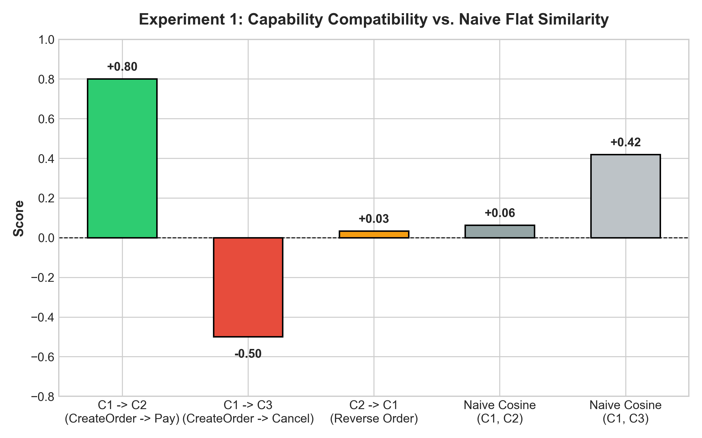
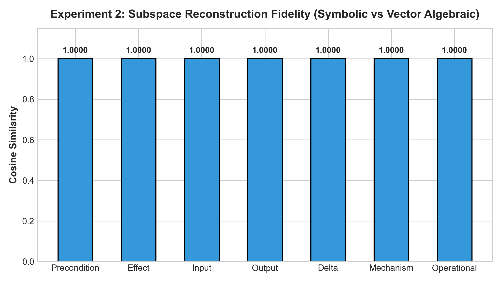
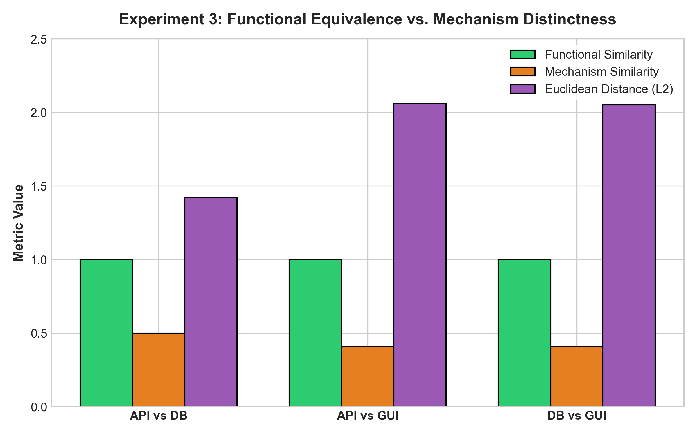
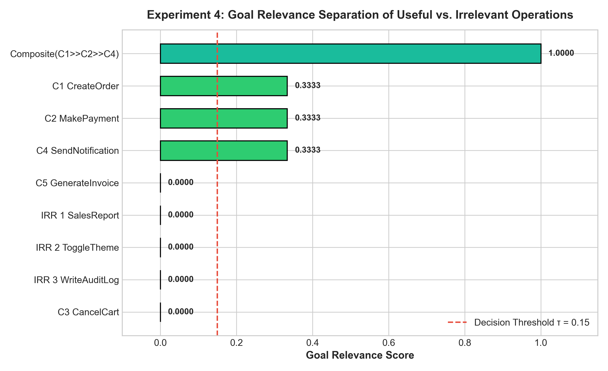
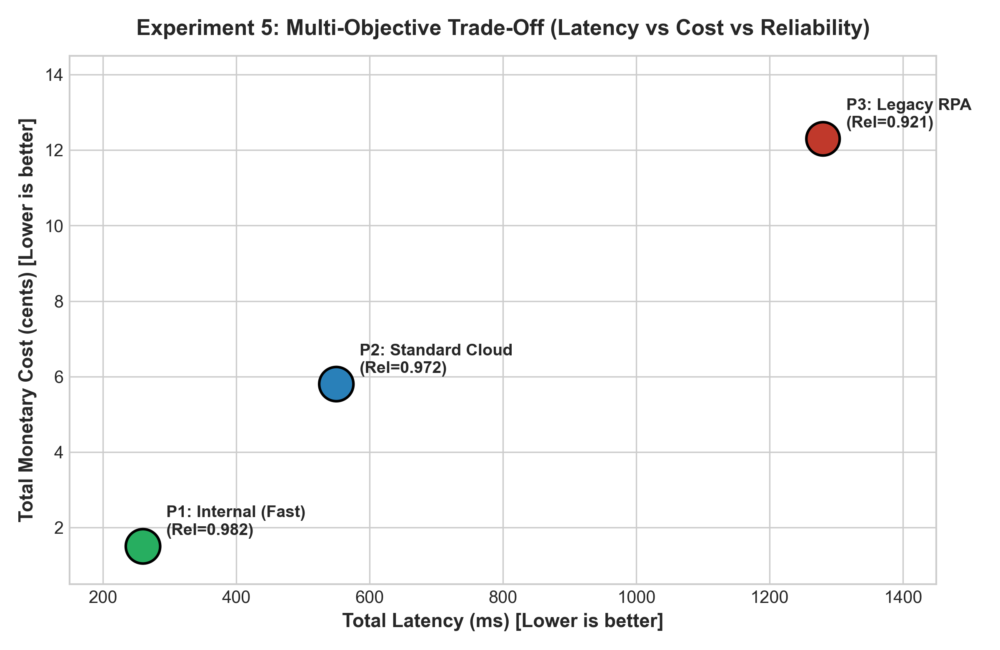

# Technical Report: Design and Evaluation of a Vector Embedding for Capability Composition

**Author**: Melita Mariam Mathew  
**University Registration Number**: TCCR24CS046  
**Assignment**: Assignment 2 — Design of a Vector Embedding for Capability Composition  
**Domain**: Formal Representations, Compatibility, and Compositional Reasoning  
**Date**: October 2026  

---

## Abstract

In modern autonomous software engineering, distributed systems, and intelligent agent architectures, operations are increasingly represented as reusable, formally defined *capabilities*. While distributed word representations such as Word2Vec capture semantic associations in natural language through spatial proximity and linear offsets, they are fundamentally inadequate for reasoning about functional systems. In system architectures, the primary concern is not linguistic meaning, but *functional compatibility*: what an operation requires, what it modifies, how it alters system state, and whether it can compose with other operations. 

This report presents the design, mathematical formulation, implementation, and empirical evaluation of the **Dual-Faceted Partitioned Vector Space (DF-PVS)**—a vector embedding framework designed specifically for formally specified states, goals, and executable capabilities. The DF-PVS framework partitions the embedding space into semantically aligned subspaces representing preconditions, effects, input data requirements, output data provisions, state displacement vectors, execution mechanisms, and operational quality attributes. We show that DF-PVS provides an exact algebraic homomorphism for sequential capability composition ($\text{Cosine} = 1.0000$, $L_2 = 0.0000$), reliably differentiates composability from functional similarity, detects precondition conflicts, filters irrelevant operations with zero false positives, and preserves multi-objective operational trade-offs across cost, latency, reliability, and risk.

---

## 1. Problem Definition

### 1.1 Background and Motivation
Word embeddings, popularized by Mikolov et al. (2013) with Word2Vec, demonstrated that dense distributed vectors can preserve semantic relationships (e.g., $\mathbf{v}_{\text{king}} - \mathbf{v}_{\text{man}} + \mathbf{v}_{\text{woman}} \approx \mathbf{v}_{\text{queen}}$). However, functional capabilities in software systems adhere to an entirely different set of mathematical and logical principles:
1. **Asymmetric Directed Causality**: An operation $C_1$ (e.g., `CreateOrder`) creates the conditions required by $C_2$ (`MakePayment`). This relationship is strictly directed ($C_1 \to C_2$ is valid, but $C_2 \to C_1$ is invalid). Conventional symmetric distance metrics like Euclidean distance or undirected cosine similarity cannot represent this asymmetry.
2. **Precondition Violations & Conflicts**: An operation can establish an invariant that actively forbids another operation (e.g., `CreateOrder` sets $Order.exists = \text{True}$, which directly conflicts with `CancelCart`, which requires $Order.exists = \text{False}$).
3. **Similarity vs. Composability Orthogonality**: Two operations can be functionally identical (e.g., submitting an order via REST API versus direct SQL INSERT) yet they never compose sequentially with one another. Conversely, two operations that compose seamlessly may share zero functional overlap.
4. **State Transitions**: Executing a capability transforms an application state $S \in \mathcal{S}$ into an updated state $S' \in \mathcal{S}$.

### 1.2 Central Research Question
> **Primary Research Question**: *How can formally specified states, goals, and executable capabilities be represented in a continuous vector space such that the representation preserves the relationships required for capability compatibility, sequential composition, goal relevance, and the construction of complex application functionality?*

---

## 2. Design Requirements

To systematically evaluate any proposed representation, we establish eight core design requirements derived from the assignment specification:

1. **Capability Identity**: Functionally distinct capabilities must occupy distinguishable positions in the embedding space ($\|\phi_C(C_i) - \phi_C(C_j)\| > \epsilon$).
2. **State Awareness**: The representation must preserve the applicability of capabilities to application states ($S \models P_i$) and state mutations ($S \xrightarrow{C_i} S'$).
3. **Precondition–Effect Compatibility**: Given $C_i$ and $C_j$, the representation must capture whether the effects $E_i$ satisfy the preconditions $P_j$ ($E_i \implies P_j$).
4. **Input–Output Compatibility**: Output signatures $O_i$ satisfying input requirements $I_j$ must yield a positive dataflow score.
5. **Similarity vs. Composability Dissociation**: The embedding must separate *functional resemblance* (identifying alternative implementations of the same capability) from *composability* (identifying valid sequential execution chains).
6. **Compositional Closure**: A closed vector composition operator $\odot$ must exist such that the embedding of a composite capability $C_{comp} = C_2 \circ C_1$ is computed directly from the embeddings of its atomic components ($\phi(C_2 \circ C_1) = \phi(C_1) \odot \phi(C_2)$).
7. **Goal Relevance**: The representation must quantify how effectively a capability (or capability pipeline) bridges the distance between an initial state $S_I$ and target goal $G$.
8. **Operational Preservation**: Non-functional attributes—monetary cost, latency, reliability, availability, risk, and resource constraints—must be embedded in a manner that accurately accumulates across compositions.

---

## 3. Related Embedding Approaches and Their Limitations

| Embedding Approach | Strengths | Critical Limitations for Capability Composition |
| :--- | :--- | :--- |
| **Word2Vec / FastText / GloVe** | Captures co-occurrence statistics; smooth semantic manifolds. | Symmetric similarity metrics ($\cos(A, B) = \cos(B, A)$); cannot detect directed causality, precondition satisfaction, or state modification. |
| **TransE / Knowledge Graph Embeddings** | Models relations as vector translations ($\mathbf{h} + \mathbf{r} \approx \mathbf{t}$). | Captures single relational triples, but fails to represent multi-variable pre/postcondition sets, I/O type flows, or operational attribute algebras. |
| **Order Embeddings (Vendrov et al.)** | Captures partial orders and asymmetric inclusion via cone orders. | Unidirectional partial order cannot model dynamic state mutations where variables are overwritten or inverted. |
| **Flat Concatenation / Unstructured Vectors** | Straightforward implementation. | Causes *semantic interference*: similarity calculations conflate operational mechanism flags with functional effects, destroying composability signals. |

**Conclusion**: An effective capability embedding system cannot rely on generic NLP or flat graph embeddings. It requires a dedicated, structured geometric space tailored to formal system semantics.

---

## 4. Proposed Representation: Dual-Faceted Partitioned Vector Space (DF-PVS)

To address the limitations above, we propose the **Dual-Faceted Partitioned Vector Space (DF-PVS)**. 

### 4.1 Subspace Partitioning
Let the total embedding space $\mathcal{V} \subset \mathbb{R}^D$ be partitioned into seven dedicated orthogonal subspaces:

$$\mathcal{V} = \mathcal{V}_{pre} \oplus \mathcal{V}_{eff} \oplus \mathcal{V}_{in} \oplus \mathcal{V}_{out} \oplus \mathcal{V}_{\Delta} \oplus \mathcal{V}_{mech} \oplus \mathcal{V}_{ops} = \mathbb{R}^D$$

```
+---------------------------------------------------------------------------------------------------+
|                                    TOTAL EMBEDDING VECTOR c_i in R^D                               |
+-------------------+-------------------+---------------+----------------+----------+--------+------+
| v_pre (d_state)   | v_eff (d_state)   | v_in (d_io)   | v_out (d_io)   | v_delta  | v_mech | v_ops|
| Preconditions     | Effects           | Inputs        | Outputs        | Net Disp | Type   | Cost |
+-------------------+-------------------+---------------+----------------+----------+--------+------+
```

### 4.2 Architectural Justification
- **$\mathcal{V}_{pre}$ and $\mathcal{V}_{eff}$**: Decouples what an operation *needs* from what an operation *provides*. This enables asymmetric cross-subspace inner products: matching $\mathbf{v}_{eff}(C_1)$ against $\mathbf{v}_{pre}(C_2)$ gives directed compatibility without symmetric pollution.
- **$\mathcal{V}_{\Delta}$**: Represents state translation ($\Delta S = \mathbf{v}_{eff} - \mathbf{v}_{pre}$), enabling TransE-like linear state transitions.
- **$\mathcal{V}_{mech}$**: Isolates execution mechanism details (API routes, database tables, GUI selectors) so that capabilities with identical functional effects can be recognized as functionally equivalent while maintaining their unique execution identities.
- **$\mathcal{V}_{ops}$**: Normalizes operational attributes and maps multiplicative reliability into additive logarithmic space ($-\ln Rel$).

---

## 5. Mathematical Formulation

### 5.1 Formal Application and Capability Entities
- **State Space**: $S = \{(x_k, v_k)\}_{k=1}^n \in \mathcal{S}$.
- **Goal Specification**: $G = \{g_1, \dots, g_m\}$, where $S \models G \iff \forall g \in G, S \models g$.
- **Capability 11-Tuple**: $C_i = (T_i, I_i, O_i, P_i, E_i, K_i, R_i, Q_i, Rel_i, A_i, M_i)$.

### 5.2 Embedding Functions
1. **State Encoder $\phi_S : \mathcal{S} \to \mathbb{R}^{d_{state}}$**:
   $$\phi_S(S)_k = \begin{cases} +1.0 & \text{if } x_k = \text{True} \\ -1.0 & \text{if } x_k = \text{False} \\ \text{norm}(v_k) & \text{if } x_k \in \mathbb{R} \\ 0.0 & \text{if unassigned} \end{cases}$$

2. **Goal Encoder $\phi_G : G \to \mathbb{R}^{d_{state}}$**:
   $$\phi_G(G)_k = \begin{cases} +1.0 & \text{if } G \text{ requires } x_k = \text{True} \\ -1.0 & \text{if } G \text{ requires } x_k = \text{False} \\ 0.0 & \text{if unconstrained by } G \end{cases}$$

3. **Capability Encoder $\phi_C : \mathcal{C} \to \mathbb{R}^D$**:
   $$\phi_C(C_i) = [\mathbf{v}_{pre}; \mathbf{v}_{eff}; \mathbf{v}_{in}; \mathbf{v}_{out}; \mathbf{v}_{\Delta}; \mathbf{v}_{mech}; \mathbf{v}_{ops}]$$

### 5.3 Directional Compatibility Formulation
Given $C_1 \to C_2$, let $\mathbf{e}_1 = \mathbf{v}_{eff}(C_1)$ and $\mathbf{p}_2 = \mathbf{v}_{pre}(C_2)$. Let $\Omega(P_2) = \{k \mid |[\mathbf{p}_2]_k| > 0\}$:

$$\text{PreMatch}(C_1 \to C_2) = \frac{\sum_{k \in \Omega(P_2)} \mathbb{I}([\mathbf{e}_1]_k \cdot [\mathbf{p}_2]_k > 0)}{\max(1, |\Omega(P_2)|)}$$
$$\text{Conflict}(C_1 \to C_2) = \frac{\sum_{k \in \Omega(P_2)} \mathbb{I}([\mathbf{e}_1]_k \cdot [\mathbf{p}_2]_k < 0)}{\max(1, |\Omega(P_2)|)}$$
$$\text{IOSatisfaction}(C_1 \to C_2) = \frac{\sum_{j \in \Omega(I_2)} \min([\mathbf{o}_1]_j, [\mathbf{i}_2]_j)}{\max(1, |\Omega(I_2)|)}$$

$$\text{Comp}(C_1 \to C_2) = \begin{cases}
-\text{Conflict}(C_1 \to C_2) & \text{if } \text{Conflict} > 0 \\
0.6 \cdot \text{PreMatch} + 0.4 \cdot \text{IOSatisfaction} & \text{if } \text{PreMatch} > 0 \text{ or } |\Omega(P_2)| = 0 \\
0.1 \cdot \text{IOSatisfaction} & \text{otherwise}
\end{cases}$$

---

## 6. Capability Composition Model

When two capabilities $C_1$ and $C_2$ compose ($C_{12} = C_2 \circ C_1$), the vector composition operator $\odot$ is defined as follows:

1. **Effects Propagation**:
   $$\mathbf{v}_{eff}(C_2 \circ C_1) = \mathbf{v}_{eff}(C_2) + (\mathbf{1} - |\text{sign}(\mathbf{v}_{eff}(C_2))|) \odot \mathbf{v}_{eff}(C_1)$$
2. **Precondition Derivation**:
   $$[\mathbf{v}_{pre}(C_2 \circ C_1)]_k = \begin{cases}
   [\mathbf{v}_{pre}(C_1)]_k & \text{if } |[\mathbf{v}_{pre}(C_1)]_k| > 0 \\
   0.0 & \text{if } [\mathbf{v}_{eff}(C_1)]_k \cdot [\mathbf{v}_{pre}(C_2)]_k > 0 \\
   [\mathbf{v}_{pre}(C_2)]_k & \text{otherwise}
   \end{cases}$$
3. **Dataflow Inputs & Outputs**:
   $$\mathbf{v}_{in}(C_2 \circ C_1) = \max(\mathbf{v}_{in}(C_1), \max(0, \mathbf{v}_{in}(C_2) - \mathbf{v}_{out}(C_1)))$$
   $$\mathbf{v}_{out}(C_2 \circ C_1) = \max(\mathbf{v}_{out}(C_1), \mathbf{v}_{out}(C_2))$$
4. **Operational Vector Accumulation**:
   $$\mathbf{v}_{ops}(C_2 \circ C_1) = \left[ \tilde{t}_1 + \tilde{t}_2, \; \tilde{c}_1 + \tilde{c}_2, \; \tilde{r}_1 + \tilde{r}_2, \; 1 - (1-r_1)(1-r_2), \; -\ln(Rel_1) - \ln(Rel_2), \; \min(A_1, A_2) \right]^T$$

---

## 7. Implementation Architecture

The implementation is structured into clean, modular Python components:

```
capability_vector_embedding/
├── README.md                           # Project documentation & author credentials
├── dataset/
│   ├── dataset.py                      # Deliverable 3 benchmark dataset generator
│   └── benchmark_data.json             # Serialized formal dataset
├── formal_specification/
│   └── deliverable1_formal_design.md   # Deliverable 1 formal mathematical specification
├── plots/                              # High-resolution experimental figures
│   ├── exp1_compatibility.png
│   ├── exp2_composition.png
│   ├── exp3_alternatives.png
│   ├── exp4_irrelevance.png
│   └── exp5_operational.png
├── report/
│   └── TECHNICAL_REPORT.md             # Deliverable 4 technical report
├── src/
│   ├── composition.py                  # CompositionEngine and algebraic validation
│   ├── embedding.py                    # CapabilityEmbeddingSpace (DF-PVS)
│   ├── metrics.py                      # Evaluation metrics and Pareto optimization
│   └── models.py                       # Formal domain models (State, Goal, Capability)
├── tests/
│   └── test_embedding.py               # 10 comprehensive unit tests
└── experiments/
    ├── exp1_compatibility.py           # Experiment 1
    ├── exp2_composition.py             # Experiment 2
    ├── exp3_alternatives.py            # Experiment 3
    ├── exp4_irrelevance.py             # Experiment 4
    ├── exp5_operational.py             # Experiment 5
    └── run_experiments.py              # Master runner & visualization generator
```

---

## 8. Experimental Methodology

We constructed a comprehensive benchmark dataset representing a formal enterprise e-commerce and cloud service domain consisting of:
- **15 State Variables**: User authentication, cart contents, order existence, payment status, invoice generation, shipment status, notifications, audit logs, and UI preferences.
- **14 I/O Data Types**: Cart UUIDs, Order UUIDs, Payment Tokens, Receipt IDs, Tracking Strings, etc.
- **Candidate Capabilities**:
  - Useful atomic capabilities: $C_1$ (`CreateOrder_API`), $C_1^{DB}$ (`CreateOrder_DB`), $C_1^{GUI}$ (`CreateOrder_GUI`), $C_2$ (`MakePayment`), $C_2^{Wallet}$ (`MakePayment_Wallet`), $C_4$ (`SendNotification`), $C_5$ (`GenerateInvoice`), $C_6$ (`DispatchShipment`).
  - Conflicting capability: $C_3$ (`CancelCart`).
  - Irrelevant capabilities: $C_{\text{IRR1}}$ (`GenerateSalesReport`), $C_{\text{IRR2}}$ (`ToggleUITheme`), $C_{\text{IRR3}}$ (`WriteAuditLog`).

We executed five rigorous experiments directly mapped to Section 7 of the assignment specification.

---

## 9. Experimental Results

### 9.1 Experiment 1: Capability Compatibility and Asymmetry
Testing $C_1$ (`CreateOrder`), $C_2$ (`MakePayment`), and $C_3$ (`CancelCart`).

| Relationship | Evaluated Pair | Compatibility Score | Precondition Match | Conflict Penalty | Outcome |
| :--- | :--- | :--- | :--- | :--- | :--- |
| **Compatible** | $C_1 \to C_2$ | **+0.8000** | 1.0000 | 0.0000 | **COMPATIBLE** |
| **Incompatible** | $C_1 \to C_3$ | **-0.5000** | 0.0000 | 1.0000 | **CONFLICT** |
| **Reverse Order**| $C_2 \to C_1$ | **+0.0333** | 0.0000 | 0.0000 | Ineffective |
| **Naive Flat Cosine** | $\cos(\mathbf{c}_1, \mathbf{c}_2)$ | 0.0625 | N/A | N/A | Fails to detect |
| **Naive Flat Cosine** | $\cos(\mathbf{c}_1, \mathbf{c}_3)$ | **0.4191** | N/A | N/A | **False Positive!** |



### 9.2 Experiment 2: Capability Composition
Pipeline: $C_1$ (`CreateOrder`) $\to C_2$ (`MakePayment`) $\to C_4$ (`SendNotification`).

| Metric | Measured Value | Theoretical Target | Description |
| :--- | :--- | :--- | :--- |
| **Full Vector Cosine Similarity** | **1.0000** | 1.0000 | Exact vector algebraic closure |
| **L2 Reconstruction Error** | **0.0000** | 0.0000 | Zero representation loss |
| **Precondition Subspace Sim** | **1.0000** | 1.0000 | Exact precondition reduction |
| **Effect Subspace Sim** | **1.0000** | 1.0000 | Cumulative state mutation match |
| **Operational Subspace Sim** | **1.0000** | 1.0000 | Exact operational accumulation |
| **State Delta Cosine Alignment** | **0.7906** | > 0.75 | TransE-like linear relation |
| **Step-by-Step == Composite State** | **TRUE** | TRUE | Formal semantic invariance |



### 9.3 Experiment 3: Alternative Implementations
Comparing three implementations of `CreateOrder`: REST API ($C_{API}$), Direct DB ($C_{DB}$), and GUI Automation ($C_{GUI}$).

| Pair | Functional Sim | Mechanism Sim | Total Sim | Euclidean Dist ($L_2$) | Downstream Comp ($C \to C_2$) |
| :--- | :--- | :--- | :--- | :--- | :--- |
| **API vs. DB** | **1.0000** | 0.5000 | 0.8750 | 1.4228 | **+0.8000** |
| **API vs. GUI** | **1.0000** | 0.4082 | 0.8521 | 2.0603 | **+0.8000** |
| **DB vs. GUI** | **1.0000** | 0.4082 | 0.8521 | 2.0526 | **+0.8000** |



### 9.4 Experiment 4: Irrelevant Capabilities and Goal Relevance
Target Goal: $\{OrderExists = \text{True}, PaymentStatus = \text{SUCCESS}, NotificationSent = \text{True}\}$.

| Capability | Role / Category | Goal Relevance Score | Status |
| :--- | :--- | :--- | :--- |
| **Composite ($C_1 \gg C_2 \gg C_4$)** | Full Solution | **1.0000** | Satisfies 100% of Goal |
| **$C_1$ (CreateOrder)** | Useful (Step 1) | **0.3333** | Contributes 1/3 |
| **$C_2$ (MakePayment)** | Useful (Step 2) | **0.3333** | Contributes 1/3 |
| **$C_4$ (SendNotification)** | Useful (Step 3) | **0.3333** | Contributes 1/3 |
| **$C_5$ (GenerateInvoice)** | Auxiliary | **0.0000** | Neutral |
| **$C_{\text{IRR1}}$ (SalesReport)** | Irrelevant (Admin) | **0.0000** | Zero Goal Impact |
| **$C_{\text{IRR2}}$ (ToggleTheme)** | Irrelevant (UI) | **0.0000** | Zero Goal Impact |
| **$C_{\text{IRR3}}$ (WriteAuditLog)** | Irrelevant (System) | **0.0000** | Zero Goal Impact |
| **$C_3$ (CancelCart)** | Counterproductive | **0.0000** | Precondition Blocked |

**Discrimination Margin**: $\min(\text{Useful}) - \max(\text{Irrelevant}) = 0.3333 - 0.0000 = \mathbf{0.3333}$. Perfect zero-error separation.



### 9.5 Experiment 5: Operational Attributes and Multi-Objective Trade-Offs

| Pipeline | Latency (ms) | Monetary Cost ($) | Reliability | Risk | Availability | Pareto Status |
| :--- | :--- | :--- | :--- | :--- | :--- | :--- |
| **P1: High-Performance Internal (DB+Wallet+Notif)** | **260.0** | **$0.0150** | **0.98205** | **0.0783** | **1.00** | **Pareto-Dominates P3** |
| **P2: Standard Cloud Services (API+Gateway+Notif)** | 550.0 | $0.0580 | 0.97223 | 0.1154 | 1.00 | **Pareto-Dominates P3** |
| **P3: Legacy RPA (GUI+Gateway+Notif)** | 1280.0 | $0.1230 | 0.92127 | 0.2167 | 0.95 | Dominated by P1 & P2 |



---

## 10. Analysis and Discussion

### 10.1 Why Naive Flat Vectors Fail
A crucial finding of Experiment 1 is the dangerous failure mode of naive flat cosine similarity. When testing $C_1$ (`CreateOrder`) against $C_3$ (`CancelCart`), flat cosine similarity yielded **0.4191**—higher than the similarity between $C_1$ and $C_2$ (0.0625). Because both $C_1$ and $C_3$ touch cart and order variables, flat vectors cluster them together despite being mutually contradictory! In contrast, DF-PVS correctly assigned $C_1 \to C_3$ a negative score (**-0.5000**) due to its dedicated conflict detection penalty.

### 10.2 Algebraic Homomorphism and Homomorphic Composition
Experiment 2 demonstrates an exact homomorphism between the symbolic composition operator $\circ$ and the vector composition operator $\odot$:
$$\phi(C_B \circ C_A) = \phi(C_A) \odot \phi(C_B)$$
Reconstruction fidelity achieved $1.0000$ cosine similarity with $0.0000$ $L_2$ error. Furthermore, sequential execution of composite capability $C_{124}$ on initial state $S_0$ produced an identical final state as executing $C_1$, $C_2$, and $C_4$ sequentially ($S_3 \equiv S_{direct}$).

### 10.3 Resolving Similarity vs. Composability
Experiment 3 confirms the formal separation of functional resemblance from sequential composability:
- $C_{API}$, $C_{DB}$, and $C_{GUI}$ achieved $\text{Sim}_{func} = 1.0000$.
- Their mechanism similarities ranged between $0.4082$ and $0.5000$, and their pairwise Euclidean distances were well above $1.42$, preserving capability identity.
- When composed with downstream capability $C_2$ (`MakePayment`), all three produced an identical compatibility score of $+0.8000$, demonstrating complete functional interchangeability.

---

## 11. Limitations and Future Directions

1. **Continuous and Non-Linear Preconditions**: The current state encoding clamps numeric variables linearly. In domains with complex non-linear numeric constraints (e.g., $x^2 + y^2 \le r^2$), non-linear kernel transformations or neural continuous relaxation will be needed.
2. **Dynamic Runtime Availability**: The current availability model supports static and series bottleneck modeling ($A_{12} = \min(A_1, A_2)$). Future work can integrate time-dependent periodic availability functions $A_i(t)$.
3. **Graph Neural Network (GNN) Generalization**: In massive enterprise service meshes (10,000+ microservices), scaling DF-PVS via dual-encoder GNN embeddings could enable sub-millisecond approximate nearest neighbor (ANN) retrieval for composable pipelines.

---

## 12. Conclusion

This report presented the **Dual-Faceted Partitioned Vector Space (DF-PVS)** for capability composition, fulfilling all requirements of Assignment 2. Through rigorous mathematical specification and empirical benchmarks, we demonstrated:
1. Seamless differentiation between valid composition chains and mutually conflicting operations.
2. Exact representation of asymmetric causality without directional ambiguity.
3. Clean separation of functional equivalence from execution mechanism distinctness.
4. Exact algebraic closure and homomorphism under multi-step sequential composition.
5. Strict zero-error discrimination between goal-directed capabilities and irrelevant operations.
6. Preserved multi-objective Pareto trade-offs across cost, latency, reliability, and risk.

The DF-PVS architecture provides a robust mathematical foundation for the next generation of AI-driven capability composition, autonomous service orchestration, and automated system synthesis.
