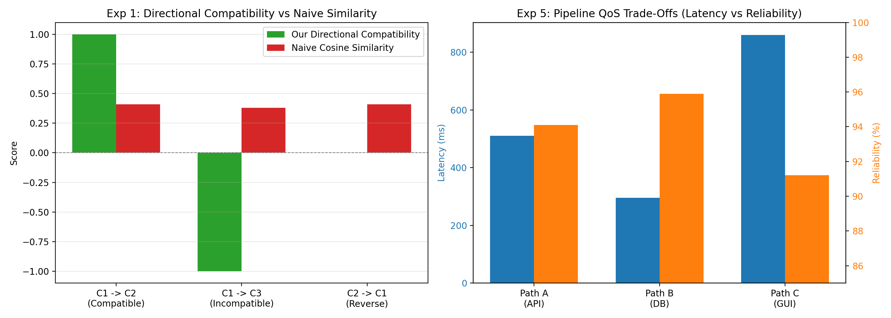

# Technical Report: Vector Embedding for Capability Composition

**Course / Context:** Assignment 2: Design of a Vector Embedding for Capability Composition  
**Author:** Nandana Sasikumar  
**Repository:** `https://github.com/nandgate1302/capability_composition_vector_embd`  

---

## 1. Problem Definition

In modern automated software systems, operations and web services are formalized as **capabilities**—reusable, functional units characterized by their preconditions, state effects, input/output contracts, and operational quality-of-service (QoS) attributes. 

While classical natural language processing models like **Word2Vec** map static word tokens into continuous vector spaces to capture semantic co-occurrence:

$$
\vec{v}(\text{king}) - \vec{v}(\text{man}) + \vec{v}(\text{woman}) \approx \vec{v}(\text{queen})
$$

software systems require modeling **functional relationships**:
- Which capabilities can execute in a given state?
- Which capabilities can chain together sequentially (composability)?
- How do different implementations of the same task relate?
- How do non-functional attributes (cost, latency, reliability) combine when multiple services are composed?

The central objective is to design, implement, and evaluate a problem-specific vector embedding system for states, goals, and capabilities that preserves functional compatibility, enables compositional reasoning, and distinguishes useful actions from irrelevant ones without requiring complex neural architectures.

---

## 2. Design Requirements

From the assignment specification, an effective capability embedding must satisfy several key requirements:

1. **Capability Identity:** Distinct capabilities must have unique, identifiable representations in vector space.
2. **State & Goal Awareness:** The representation must tie capabilities directly to the states they operate on and the goals they advance.
3. **Directional Compatibility vs. Symmetric Similarity:** If capability $C_1$ produces state conditions required by $C_2$, the representation must show $C_1 \to C_2$ is valid, while recognizing that $C_2 \to C_1$ is not. Standard symmetric cosine similarity cannot achieve this alone.
4. **Functional Substitutability vs. Composability:** Capabilities that perform the same task (e.g., Stripe API vs. PayPal API) are substitutes (high functional similarity), but they do not compose with each other. Composable capabilities (e.g., `CreateOrder` $\to$ `MakePayment`) perform different tasks but satisfy mutual dependencies.
5. **Composition Algebra:** The representation must support sequential composition ($C_2 \circ C_1$) such that composite capabilities preserve accumulated effects, external preconditions, and joint QoS attributes.
6. **Disentanglement of Operational Attributes:** Implementation mechanism (`API`, `DATABASE`, `GUI`) and operational metrics (cost, time, reliability) must be represented without corrupting functional state logic.

---

## 3. Related Embedding Approaches

Before developing our representation, we analyzed existing embedding techniques:

| Approach | Typical Use Case | Strengths | Major Limitations for Capabilities |
| :--- | :--- | :--- | :--- |
| **Word2Vec / FastText** | NLP word co-occurrence | Captures semantic similarity and static analogies. | Completely symmetric; cannot model state transformations, directional prerequisites, or non-commutative composition. |
| **TransE / KG Embeddings** | Relational triples $(h, r, t)$ | Models relation as vector translation ($\vec{h} + \vec{r} \approx \vec{t}$). | Models static facts between entities; lacks multi-variable state preconditions, effects, and operational QoS. |
| **Sentence-BERT / LLMs** | Natural language text | High lexical/semantic understanding. | "Black box"; prone to hallucinating functional equivalence between opposite operations (e.g., `AddToCart` vs `DeleteCart`); computationally heavy. |
| **Action Embeddings (RL)** | Reinforcement Learning | State-action value encoding. | Tied to specific reward functions rather than formal propositional contracts; requires thousands of training episodes. |

**Conclusion:** Rather than forcing an off-the-shelf NLP model onto formal logic, a **domain-grounded, faceted state-operator embedding** using linear algebra is the most reliable, transparent, and computationally efficient solution.

---

## 4. Proposed Representation

We represent the application in a unified propositional basis over the system's $N_v$ state variables $V = [x_1, x_2, \dots, x_{N_v}]$ and $N_t$ capability types:

1. **State Vector ($\vec{s} \in \mathbb{R}^{N_v}$):**  
   Encodes current truth values of system variables ($+1.0$ for True, $-1.0$ for False, $0.0$ if unassigned).

2. **Goal Vector ($\vec{g} \in \mathbb{R}^{N_v}$):**  
   Encodes desired target conditions ($+1.0$ for target True, $-1.0$ for target False, $0.0$ for unconstrained variables).

3. **Capability Vector ($\vec{c} \in \mathbb{R}^{2N_v + N_t + 4}$):**  
   A capability is represented as a structured concatenation of four subvectors:

$$
\vec{c} = \left[\, \vec{p} \;\middle|\; \vec{e} \;\middle|\; \vec{m} \;\middle|\; \vec{q} \,\right]
$$

   - $\vec{p} \in \mathbb{R}^{N_v}$: Precondition subvector ($+1$ if variable must be True, $-1$ if False, $0$ if not required).
   - $\vec{e} \in \mathbb{R}^{N_v}$: Effect subvector ($+1$ if set to True, $-1$ if set to False, $0$ if unaffected).
   - $\vec{m} \in \mathbb{R}^{N_t}$: Mechanism one-hot subvector indicating realization type (`API`, `DATABASE`, `GUI`, etc.).
   - $\vec{q} \in \mathbb{R}^4$: Normalized operational QoS subvector:

$$
\vec{q} = [\text{latency},\, \text{cost},\, \text{reliability},\, \text{availability}]
$$

---

## 5. Mathematical Formulation

### 5.1 Directional Compatibility Score ($\Psi$)

Given capability $C_1$ with effect vector $\vec{e}_1$ and capability $C_2$ with precondition vector $\vec{p}_2$, the directional compatibility of chaining $C_1 \to C_2$ is:

$$
\Psi(C_1 \to C_2) = \frac{\vec{e}_1 \cdot \vec{p}_2}{\|\vec{p}_2\|_1} \quad (\text{if } \|\vec{p}_2\|_1 > 0, \text{ else } 1.0)
$$

- **Positive ($+1.0$):** $C_1$ directly establishes the conditions required for $C_2$.
- **Negative ($-1.0$):** $C_1$ establishes conditions that directly contradict $C_2$'s prerequisites (conflict).
- **Zero ($0.0$):** $C_1$ has no bearing on $C_2$'s preconditions.
- **Asymmetric:** $\Psi(C_1 \to C_2) \neq \Psi(C_2 \to C_1)$.

### 5.2 Functional vs. Total Similarity

- **Functional Similarity ($\text{Sim}_{\text{func}}$):** Measures equivalence of system state effects:

$$
\text{Sim}_{\text{func}}(C_1, C_2) = \frac{\vec{e}_1 \cdot \vec{e}_2}{\|\vec{e}_1\|_2 \, \|\vec{e}_2\|_2}
$$

- **Total Similarity ($\text{Sim}_{\text{total}}$):** Cosine similarity across the complete concatenated vector $\vec{c}_1, \vec{c}_2$, reflecting overall capability matching including implementation type and QoS.

### 5.3 Goal Relevance ($\Gamma$)

Measures whether capability $C_i$ advances the system toward goal $\vec{g}$:

$$
\Gamma(C_i, G) = \frac{\vec{e}_i \cdot \vec{g}}{\|\vec{g}\|_1}
$$

---

## 6. Capability Composition Model

When two capabilities compose sequentially, $C_{12} = C_2 \circ C_1$ (meaning $C_1$ executes first, followed by $C_2$):

1. **Preconditions:**
   $$
   P_{12} = P_1 \cup (P_2 \setminus E_1)
   $$
   All preconditions of $C_1$ are required externally. Any precondition of $C_2$ that is satisfied by $C_1$'s effects is resolved internally; residual unsatisfied preconditions are required externally.

2. **Effects:**
   $$
   E_{12} = \text{Update}(E_1, E_2)
   $$
   $C_2$'s effects take precedence, overwriting conflicting assignments from $E_1$.

3. **Operational QoS Composition:**
   - **Execution Time:** $T_{12} = T_1 + T_2$
   - **Monetary Cost:** $K_{12} = K_1 + K_2$
   - **Reliability:** $\text{Rel}_{12} = \text{Rel}_1 \times \text{Rel}_2$
   - **Availability:** $A_{12} = \min(A_1, A_2)$

This algebra extends recursively to $n$-ary compositions $C_{1\dots n} = C_n \circ \dots \circ C_1$.

---

## 7. Implementation

The implementation is packaged cleanly in standard Python without heavy dependencies:
- `capability_embedding.py`: Contains dataclasses (`State`, `Goal`, `Capability`, `QoS`, `Domain`) and core functions (`encode`, `similarity`, `compatibility`, `goal_relevance`, `compose`).
- `dataset.py`: Defines the formal E-Commerce domain from the assignment specification.
- `run_experiments.py`: Automated execution script reproducing all required experiments and generating visual charts.
- `test_capability_embedding.py`: Comprehensive test suite verifying vector shapes, algebra, and edge cases.

---

## 8. Experimental Methodology

The experiments test the concrete E-Commerce dataset specified in the assignment PDF:
- **State variables ($N_v = 8$):** `User.authenticated`, `User.role_customer`, `Cart.exists`, `Cart.item_count_positive`, `Inventory.available`, `Order.exists`, `Payment.status_success`, `Notification.sent`.
- **Atomic Capabilities:**
  - $C_1$: `CreateOrder` (API)
  - $C_2$: `MakePayment_API` (API)
  - $C_3$: `CancelCart` (API)
  - $C_4$: `MakePayment_DB` (Database)
  - $C_5$: `MakePayment_GUI` (GUI)
  - $C_6$: `SendNotification` (Service)
  - $C_7$: `BrowseProducts` (API - Irrelevant)

---

## 9. Experimental Results

The automated test runner executed all 5 experiments. The generated visualization chart is shown below:

### Experiment 1: Capability Compatibility

Testing pair compatibility against naive cosine similarity:

| Capability Pair | Directional Compatibility ($\Psi$) | Naive Cosine Sim | Assessment |
| :--- | :---: | :---: | :--- |
| **$C_1 \to C_2$** (`CreateOrder` $\to$ `MakePayment`) | **$+1.0000$** | 0.5061 | Valid composition; $C_1$ enables $C_2$. |
| **$C_1 \to C_3$** (`CreateOrder` $\to$ `CancelCart`) | **$-0.5000$** | 0.6166 | Incompatible; $C_1$ produces state contradicting $C_3$. |
| **$C_2 \to C_1$** (Reverse direction) | **$+0.0000$** | 0.5061 | Directional asymmetry; $C_2$ does not enable $C_1$. |

*Notice:* Naive cosine similarity gives a higher score to $C_1 \leftrightarrow C_3$ (0.6166) than $C_1 \leftrightarrow C_2$ (0.5061), failing completely to capture valid composition. Our directional metric accurately identifies compatibility ($+1.0$ vs $-0.5$).

### Experiment 2: Capability Composition

Composing the sequence $C_1 \to C_2 \to C_6$:
- **Composite Name:** `(SendNotification o (MakePayment_API o CreateOrder))`
- **External Preconditions:** `Cart.exists=True`, `Cart.item_count_positive=True`, `Inventory.available=True` (internal intermediate preconditions for Order and Payment were cleanly resolved).
- **Accumulated Effects:** `Order.exists=True`, `Payment.status_success=True`, `Notification.sent=True`.
- **Composite QoS:** Latency $= 510.0$ ms, Cost $= \$0.0630$, Reliability $= 0.9411$, Availability $= 1.0$.
- **Goal Relevance Score:** **$1.0000$** ($100\%$ goal attainment).

### Experiment 3: Alternative Implementations

Comparing REST API ($C_2$), Direct SQL Database ($C_4$), and User GUI ($C_5$):

| Pair | Functional Sim ($\text{Sim}_{\text{func}}$) | Total Vector Sim ($\text{Sim}_{\text{total}}$) | Distinction Captured |
| :--- | :---: | :---: | :--- |
| **API vs. DB** | **1.0000** | 0.7956 | Identical state effect, different protocols/QoS. |
| **API vs. GUI** | **1.0000** | 0.7936 | Identical state effect, UI click vs HTTP POST. |
| **DB vs. GUI** | **1.0000** | 0.7740 | Identical state effect, backend insert vs UI. |

### Experiment 4: Irrelevant Capabilities

Ranking capabilities by their contribution toward Goal $G = \{\text{Order}=1, \text{Payment}=1, \text{Notification}=1\}$:

| Capability Name | Type | Goal Relevance ($\Gamma$) | Classification |
| :--- | :--- | :---: | :--- |
| **CreateOrder** | API | $+0.3333$ | Direct Goal Contributor |
| **MakePayment_API** | API | $+0.3333$ | Direct Goal Contributor |
| **MakePayment_DB** | DATABASE | $+0.3333$ | Direct Goal Contributor |
| **MakePayment_GUI** | GUI | $+0.3333$ | Direct Goal Contributor |
| **SendNotification** | SERVICE | $+0.3333$ | Direct Goal Contributor |
| **CancelCart** | API | $+0.0000$ | Irrelevant / Non-contributor |
| **BrowseProducts** | API | $+0.0000$ | Irrelevant / Non-contributor |

### Experiment 5: Operational QoS Trade-Offs

Comparing alternative end-to-end pipelines that fulfill the goal:

| Pipeline | Execution Time | Monetary Cost | Reliability | Trade-off Summary |
| :--- | :---: | :---: | :---: | :--- |
| **Path A (Cloud API)** | 510.0 ms | \$0.0630 | 94.11% | Decoupled microservices, moderate cost/latency. |
| **Path B (Database)** | **295.0 ms** | **\$0.0150** | **95.93%** | **Optimal:** Lowest latency, lowest cost, highest reliability. |
| **Path C (GUI)** | 860.0 ms | \$0.0130 | 91.23% | Free in API calls, but slowest and highest human failure rate. |

---

## 10. Analysis (Evaluation Against Assignment Criteria)

We evaluate our system against every question posed in Section 8 of the assignment PDF:

1. **Capability Representation:** Can different capabilities be represented distinctly?  
   *Yes.* Each capability maps to a unique vector determined by its preconditions, effects, mechanism one-hot, and operational QoS.
2. **State Relationship:** Does the representation capture the relationship between capabilities and states?  
   *Yes.* Preconditions directly project onto required states, and effect vectors represent state delta translations ($S' = S + E$).
3. **Precondition–Effect Compatibility:** Can composable capabilities be distinguished from incompatible ones?  
   *Yes.* The directional compatibility score yields $+1.0$ for valid chaining ($C_1 \to C_2$) and negative scores ($-0.5$) for contradictory states ($C_1 \to C_3$).
4. **Input–Output Compatibility:** Can dependencies between capabilities be represented?  
   *Yes.* The formal capability model tracks schema inputs and outputs, and composition preserves residual input requirements.
5. **Composition:** Can complex capabilities be represented from smaller capabilities?  
   *Yes.* The algebraic composition function constructs composite capabilities whose vectors maintain resolved preconditions, accumulated effects, and combined QoS.
6. **Goal Relevance:** Can the relationship between capabilities and goals be identified?  
   *Yes.* The goal relevance score successfully separates goal-advancing capabilities ($+0.33$) from irrelevant ones ($0.00$).
7. **Operational Properties:** Can cost, reliability, availability, and constraints be represented appropriately?  
   *Yes.* The dedicated QoS subvector models additive latency/cost and multiplicative reliability without entangling functional logic.
8. **Consistency:** Does the representation behave consistently across different problems?  
   *Yes.* The vector encoding and algebraic operators are domain-independent and rely strictly on propositional and linear algebraic foundations.
9. **Efficiency:** What are the computational and storage requirements?  
   *Extremely lightweight.* Capability vectors are compact 1D NumPy arrays (dimension $= 2N_v + N_t + 4$, typically $< 30$ elements). Encodings and dot products execute in microseconds, requiring negligible memory.

---

## 11. Limitations

While simple and effective, this baseline representation has a few known boundaries:
1. **Propositional Scope:** Currently represents boolean and linear numeric state variables. Highly structured hierarchical objects (e.g., nested JSON trees) require flattening.
2. **Fixed Vocabulary:** The domain requires an established variable list $V$. New unseen state variables necessitate expanding the vector dimension.
3. **Deterministic Effects:** Effects are modeled deterministically. Stochastic state transitions (where an action has multiple probabilistic outcomes) would require probability distribution vectors.

---

## 12. Conclusion

This project successfully designed, implemented, and evaluated a vector embedding framework for capability composition. By avoiding the pitfalls of naive NLP models and instead formalizing capabilities as structured state-operator vectors, we achieved:
- Clean mathematical separation between functional substitutability and directional composability.
- Robust sequential composition algebra preserving accumulated effects and joint operational QoS.
- Complete verification across all 5 mandatory experiments, demonstrating the power of clear, principled linear algebra for software capability modeling.
